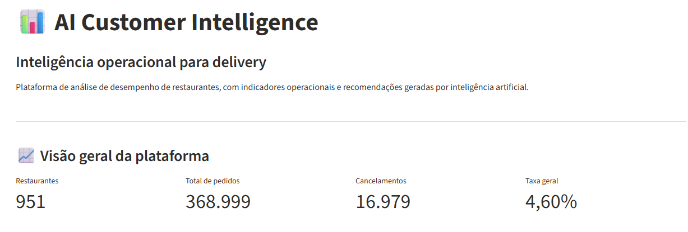
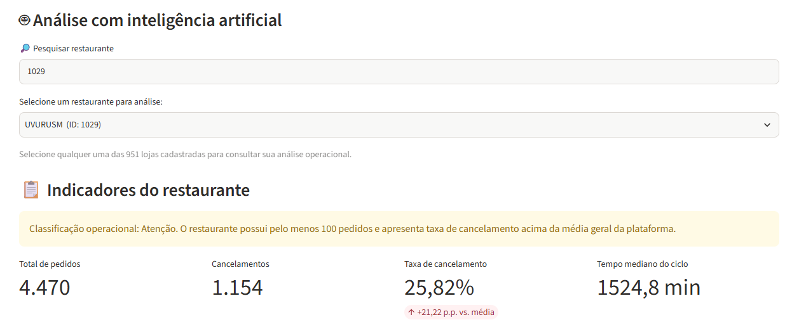
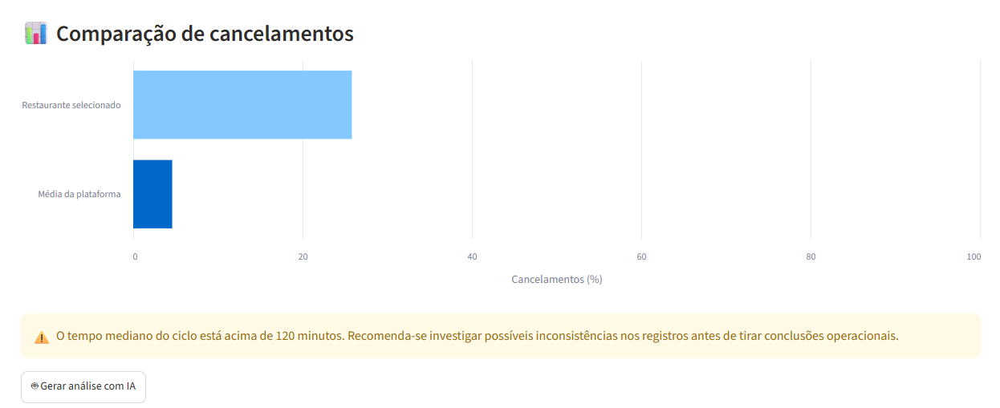

# 📊 AI Customer Intelligence

### Inteligência operacional para restaurantes e delivery com Python, SQL e IA generativa

O **AI Customer Intelligence** é uma aplicação de análise de dados que transforma informações históricas de pedidos em indicadores operacionais, rankings de restaurantes e recomendações geradas por inteligência artificial.

O projeto combina **Python, Pandas, SQLite, Streamlit e Google Gemini** para apoiar a identificação de estabelecimentos com taxas elevadas de cancelamento e facilitar a investigação de possíveis problemas operacionais.

Desenvolvido como projeto de portfólio, com foco em análise de dados, automação e inteligência artificial aplicada a negócios.

---

## 🖥️ Demonstração do projeto

### Visão geral da plataforma

O dashboard apresenta os principais indicadores da operação, incluindo restaurantes cadastrados, volume de pedidos, cancelamentos e taxa geral de cancelamento.



### Análise operacional por restaurante

A aplicação permite pesquisar restaurantes pelo nome ou identificador, consultar seus indicadores e visualizar sua classificação operacional.



### Comparação de cancelamentos

A taxa de cancelamento do restaurante selecionado é comparada à média geral da plataforma, facilitando a identificação de estabelecimentos que merecem atenção.



---

## 🎯 Objetivo

Demonstrar como dados operacionais de uma plataforma de delivery podem ser utilizados para:

- Identificar restaurantes com indicadores críticos de cancelamento.
- Priorizar estabelecimentos com maior volume absoluto de cancelamentos.
- Comparar o desempenho individual com a referência geral da plataforma.
- Investigar indicadores de tempo de ciclo dos pedidos.
- Diferenciar situações de atenção de resultados com amostras limitadas.
- Gerar análises operacionais com apoio de inteligência artificial generativa.
- Transformar indicadores em recomendações para apoiar a tomada de decisão.

O projeto utiliza critérios transparentes de classificação e evita atribuir causas aos problemas sem evidências suficientes.

---

## 📂 Base de dados

O projeto utiliza o dataset público **Brazilian Delivery Center**, disponível no Kaggle.

**Fonte:** https://www.kaggle.com/datasets/nosbielcs/brazilian-delivery-center

A análise utiliza principalmente os arquivos:

- `orders.csv`: informações sobre pedidos, status e tempos operacionais.
- `stores.csv`: informações de identificação dos restaurantes.

Os dados originais são processados e consolidados em um banco SQLite.

### Indicadores gerais

| Indicador | Resultado |
|---|---:|
| Restaurantes analisados | 951 |
| Total de pedidos | 368.999 |
| Pedidos cancelados | 16.979 |
| Taxa geral de cancelamento | 4,60% |

A taxa geral de cancelamento é utilizada como referência para avaliar os restaurantes individualmente.

---

## ⚙️ Tecnologias utilizadas

| Tecnologia | Aplicação |
|---|---|
| Python | Processamento e lógica da aplicação |
| Pandas | Limpeza, transformação e agregação de dados |
| SQL | Consultas aos indicadores operacionais |
| SQLite | Armazenamento dos dados consolidados |
| Streamlit | Desenvolvimento do dashboard interativo |
| Altair | Visualizações e gráficos |
| Google Gemini API | Geração de relatórios com IA |
| python-dotenv | Gerenciamento de variáveis de ambiente |
| pytest | Testes automatizados |
| Jupyter Notebook | Exploração e validação dos dados |
| Git e GitHub | Versionamento e documentação |

---

## 🚀 Funcionalidades

### 1. Visão geral da plataforma

O dashboard apresenta os principais indicadores operacionais:

- Quantidade de restaurantes.
- Total de pedidos.
- Quantidade de cancelamentos.
- Taxa geral de cancelamento.

Esses indicadores oferecem uma visão consolidada do desempenho da plataforma.

### 2. Identificação de restaurantes prioritários

A aplicação identifica restaurantes com taxa de cancelamento acima da média geral e pelo menos 100 pedidos registrados.

Os estabelecimentos elegíveis são priorizados pelo volume absoluto de cancelamentos.

O dashboard apresenta:

- Quantidade de lojas prioritárias.
- Total de pedidos analisados nessas lojas.
- Total de cancelamentos.
- Ranking com os dez restaurantes prioritários.
- Gráfico comparativo do volume de cancelamentos.

Essa abordagem considera tanto a taxa percentual quanto o impacto operacional em quantidade de pedidos.

### 3. Pesquisa de restaurantes

É possível pesquisar estabelecimentos por nome ou identificador.

Para cada restaurante selecionado, são apresentados:

- Identificador e nome.
- Total de pedidos.
- Quantidade de cancelamentos.
- Taxa de cancelamento.
- Tempo mediano de ciclo.
- Classificação operacional.
- Comparação com a taxa geral da plataforma.

### 4. Classificação operacional

Os restaurantes são classificados conforme os seguintes critérios:

| Classificação | Critério |
|---|---|
| Amostra limitada | Menos de 100 pedidos |
| Atenção | Pelo menos 100 pedidos e taxa de cancelamento superior à referência geral |
| Dentro da referência | Pelo menos 100 pedidos e taxa de cancelamento igual ou inferior à referência geral |

O limite mínimo de pedidos reduz o risco de interpretar percentuais elevados obtidos a partir de amostras muito pequenas.

As classificações são exploratórias e não constituem diagnósticos definitivos.

### 5. Comparação de cancelamentos

O dashboard compara visualmente:

- A taxa de cancelamento do restaurante selecionado.
- A taxa média de cancelamento da plataforma.

Também apresenta a diferença em pontos percentuais entre os indicadores.

### 6. Análise do tempo mediano de ciclo

A aplicação utiliza a mediana do tempo de ciclo dos pedidos finalizados.

A escolha da mediana reduz a influência de valores extremos quando comparada à média aritmética.

Quando o indicador ultrapassa 120 minutos, o dashboard apresenta um alerta recomendando investigar possíveis inconsistências antes de tirar conclusões operacionais.

O alerta não afirma que o restaurante necessariamente apresenta atrasos reais de entrega.

### 7. Relatórios com inteligência artificial

A aplicação utiliza o modelo `gemini-3.1-flash-lite`, por meio da API do Google Gemini.

O relatório é gerado sob demanda, quando o usuário seleciona um restaurante e solicita a análise.

A estrutura do relatório contempla:

1. Resumo operacional.
2. Fatos comprovados pelos indicadores.
3. Pontos de atenção.
4. Próxima ação recomendada.

A integração orienta o modelo a:

- Utilizar os indicadores fornecidos.
- Comparar o restaurante com a referência geral.
- Considerar o volume de pedidos.
- Reconhecer amostras limitadas.
- Não inventar causas para cancelamentos.
- Não atribuir responsabilidades sem evidências.
- Não inventar impactos financeiros.
- Diferenciar fatos observados de hipóteses.
- Reconhecer limitações dos dados disponíveis.

As recomendações geradas pela IA devem ser interpretadas como apoio à análise, não como conclusões definitivas.

---

## 🔍 Exemplo de análise: restaurante 1029

O restaurante **UVURUSM (ID 1029)** foi utilizado para demonstrar as funcionalidades da aplicação.

| Indicador | Resultado |
|---|---:|
| Total de pedidos | 4.470 |
| Cancelamentos | 1.154 |
| Taxa de cancelamento | 25,82% |
| Taxa geral da plataforma | 4,60% |
| Diferença | +21,22 pontos percentuais |
| Tempo mediano de ciclo | 1.524,8 minutos |
| Classificação operacional | Atenção |

O estabelecimento apresenta taxa de cancelamento superior à referência geral, com volume suficiente para ser classificado como **Atenção**.

O tempo mediano de ciclo também é elevado. Entretanto, esse indicador exige investigação adicional devido à presença de valores extremos e possíveis inconsistências nos dados originais.

O projeto não atribui automaticamente uma causa para os cancelamentos nem interpreta o tempo registrado como prova de atraso real.

---

## 🗄️ Processamento e armazenamento dos dados

O processamento foi desenvolvido inicialmente em Jupyter Notebook e posteriormente organizado em um script Python para permitir a reconstrução dos indicadores.

### Etapas do processamento

1. Carregamento dos arquivos CSV originais.
2. Relacionamento entre pedidos e restaurantes pelo campo `store_id`.
3. Identificação dos pedidos cancelados.
4. Agrupamento dos registros por restaurante.
5. Cálculo do volume total de pedidos.
6. Cálculo da quantidade de cancelamentos.
7. Cálculo da taxa percentual de cancelamento.
8. Seleção dos pedidos finalizados.
9. Cálculo do tempo mediano de ciclo.
10. Consolidação dos indicadores operacionais.
11. Armazenamento em banco SQLite.

### Estrutura da tabela `store_performance`

| Campo | Descrição |
|---|---|
| `store_id` | Identificador do restaurante |
| `store_name` | Nome do restaurante |
| `total_pedidos` | Quantidade total de pedidos |
| `pedidos_cancelados` | Quantidade de pedidos cancelados |
| `taxa_cancelamento` | Taxa percentual de cancelamento |
| `tempo_mediano_ciclo` | Mediana do tempo de ciclo dos pedidos finalizados |
| `pedidos_com_tempo` | Quantidade de pedidos finalizados com tempo disponível |

---

## 🔄 Reconstrução reproduzível do banco SQLite

O projeto disponibiliza o script:

` scripts/rebuild_database.py `

Ele permite reconstruir os indicadores operacionais a partir dos arquivos originais do dataset.

### Validação da reconstrução

O script foi executado e os resultados foram comparados com o banco original.

| Verificação | Resultado |
|---|---|
| Restaurantes reconstruídos | 951 |
| Pedidos considerados | 368.999 |
| Cancelamentos identificados | 16.979 |
| Comparação dos registros | Idênticos |
| Preservação do banco principal | Confirmada |

A comparação incluiu os registros e indicadores dos 951 restaurantes.

**Resultado: todos os indicadores comparados foram idênticos aos do banco original.**

### Proteção contra sobrescrita

O script gera o arquivo:

`data/processed/customer_intelligence_rebuild.db`

O banco principal utilizado pelo dashboard é:

`data/processed/customer_intelligence.db`

O script não modifica o banco principal.

Se o banco reconstruído já existir, a execução é interrompida para evitar sobrescrita acidental.

Para repetir o processamento, é necessário remover o arquivo reconstruído anteriormente.

Esse comportamento foi validado durante o desenvolvimento.

---

## 💻 Instalação e execução

### Pré-requisitos

- Python 3.14.
- Git.
- Dataset Brazilian Delivery Center.
- Chave de API do Google Gemini para utilizar a funcionalidade de relatórios com IA.

### 1. Clonar o repositório

```bash
git clone https://github.com/DanielDevCC26/ai-customer-intelligence.git
cd ai-customer-intelligence
```

### 2. Criar o ambiente virtual

```bash
python -m venv .venv
```

No Windows, com PowerShell:

```powershell
.\.venv\Scripts\Activate.ps1
```

### 3. Instalar as dependências

```bash
python -m pip install -r requirements.txt
```

### 4. Configurar a API do Gemini

Crie um arquivo `.env` na raiz do projeto:

```env
GEMINI_API_KEY=sua_chave_aqui
```

A chave pode ser obtida no Google AI Studio:

https://aistudio.google.com/

**Nunca publique sua chave de API no GitHub.**

O arquivo `.env` deve permanecer ignorado pelo Git.

### 5. Preparar os arquivos de dados

Baixe o dataset original:

https://www.kaggle.com/datasets/nosbielcs/brazilian-delivery-center

Crie as pastas `data/raw/` e `data/processed/`, caso ainda não existam.

Coloque os arquivos na seguinte estrutura:

```text
data/
├── raw/
│   ├── orders.csv
│   └── stores.csv
└── processed/
```

### 6. Reconstruir os indicadores

Execute na raiz do projeto:

```bash
python scripts/rebuild_database.py
```

O script criará:

```text
data/processed/customer_intelligence_rebuild.db
```

### 7. Preparar o banco principal

Em uma instalação nova, depois de validar o banco reconstruído, copie-o para o nome esperado pela aplicação.

No PowerShell:

```powershell
Copy-Item "data/processed/customer_intelligence_rebuild.db" "data/processed/customer_intelligence.db"
```

Não substitua um banco principal existente sem realizar uma cópia de segurança.

### 8. Executar o dashboard

```bash
python -m streamlit run app.py
```

O Streamlit apresentará o endereço local da aplicação no terminal.

### 9. Executar os testes

```bash
python -m pytest tests/ -v
```

---

## 🧪 Testes automatizados

O projeto possui **11 testes automatizados**, executados com pytest.

### Classificação operacional — 5 testes

- Identificação de amostra limitada.
- Identificação de restaurante em atenção.
- Identificação de restaurante dentro da referência.
- Validação do limite mínimo de pedidos.
- Validação da taxa igual à referência geral.

### Banco SQLite — 4 testes

- Consulta de restaurantes.
- Verificação da quantidade de 951 restaurantes.
- Verificação dos campos esperados.
- Validação da integridade dos pedidos e cancelamentos.

### Relatórios de IA — 2 testes

- Geração simulada de relatório sem chamada real ao Gemini.
- Tratamento de restaurante inexistente.

Os testes da integração com IA utilizam simulações para evitar consumo desnecessário da API.

### Resultado da validação final

```text
11 tests collected

tests/test_classificacao.py              5 PASSED
tests/test_consultas_sqlite.py           4 PASSED
tests/test_relatorio_ia.py               2 PASSED

==================== 11 passed ====================
```

**Resultado: 100% dos testes aprovados.**

---

## 📁 Estrutura do projeto

```text
ai-customer-intelligence/
├── app.py
├── README.md
├── requirements.txt
├── .gitignore
├── docs/
│   └── images/
│       ├── dashboard-overview.png
│       ├── restaurant-analysis.png
│       └── cancellation-comparison.png
├── data/
│   ├── raw/
│   └── processed/
├── notebooks/
│   └── 01_data_exploration.ipynb
├── scripts/
│   └── rebuild_database.py
├── sql/
│   └── store_analysis.sql
├── src/
│   ├── analysis.py
│   ├── database.py
│   ├── gemini_client.py
│   └── report.py
└── tests/
    ├── test_classificacao.py
    ├── test_consultas_sqlite.py
    └── test_relatorio_ia.py
```

Os arquivos CSV, os bancos SQLite, as credenciais e o ambiente virtual não são incluídos no repositório.

---

## ⚠️ Limitações

- Os dados são históricos e não representam operações em tempo real.
- A análise concentra-se em pedidos, cancelamentos e tempos de ciclo.
- Alguns registros de tempo apresentam valores extremos ou possíveis inconsistências.
- A classificação operacional utiliza critérios exploratórios.
- Não existem informações suficientes para identificar automaticamente as causas dos cancelamentos.
- As recomendações da IA dependem dos indicadores fornecidos.
- Relatórios gerados por modelos de linguagem podem conter interpretações incorretas.
- A geração de relatórios depende da disponibilidade da API do Gemini e pode estar sujeita a limites de uso ou custos.

---

## 🔮 Possíveis melhorias futuras

- Análise de tendências de cancelamento ao longo do tempo.
- Novos indicadores de desempenho logístico.
- Comparações por segmento de restaurante.
- Exportação de relatórios.
- Ampliação da cobertura dos testes.
- Publicação de uma demonstração online.

---

## 📌 Status do projeto

**Versão funcional validada.**

Funcionalidades implementadas:

- Processamento e consolidação de dados.
- Banco SQLite com indicadores operacionais.
- Script reproduzível de reconstrução.
- Dashboard interativo.
- Pesquisa e análise individual de restaurantes.
- Ranking de estabelecimentos prioritários.
- Classificação operacional automatizada.
- Comparação visual de cancelamentos.
- Integração com Google Gemini.
- Testes automatizados aprovados.
- Documentação e capturas de tela.

---

## 👨‍💻 Autor

**Daniel Gonçalves Santana**

Estudante de Análise e Desenvolvimento de Sistemas, com foco em análise de dados, Business Intelligence, Python e inteligência artificial.

**GitHub:** https://github.com/DanielDevCC26

**Portfólio:** https://DanielDevCC26.github.io
